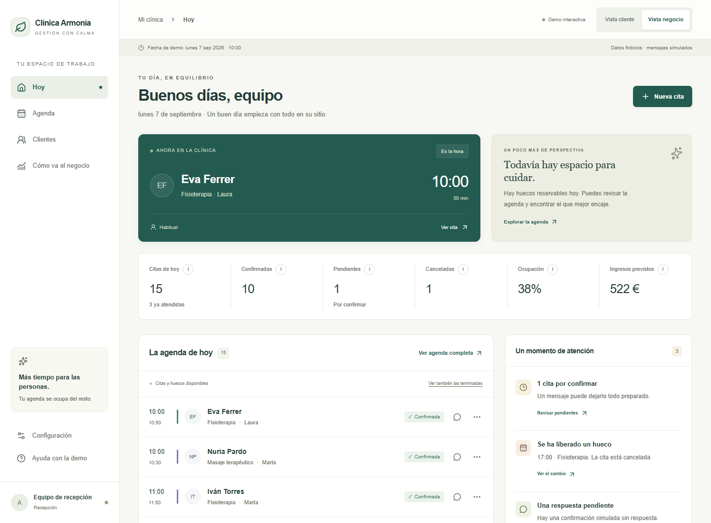
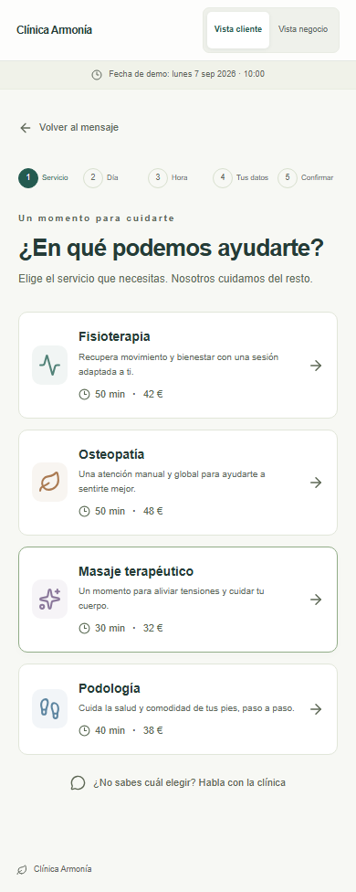
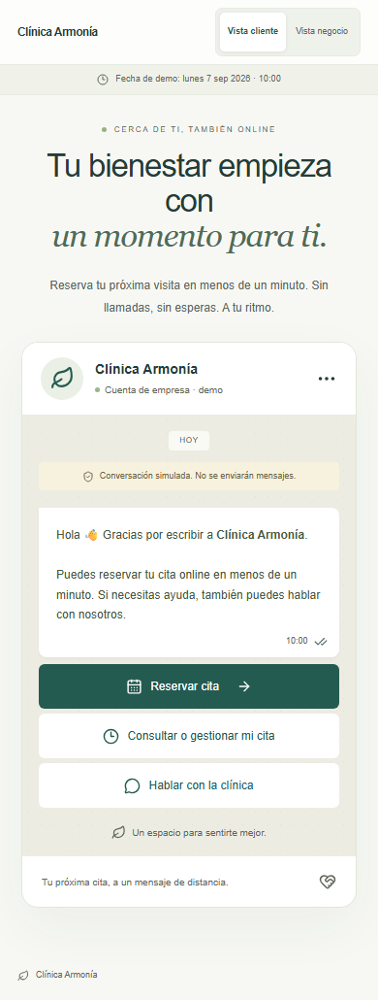
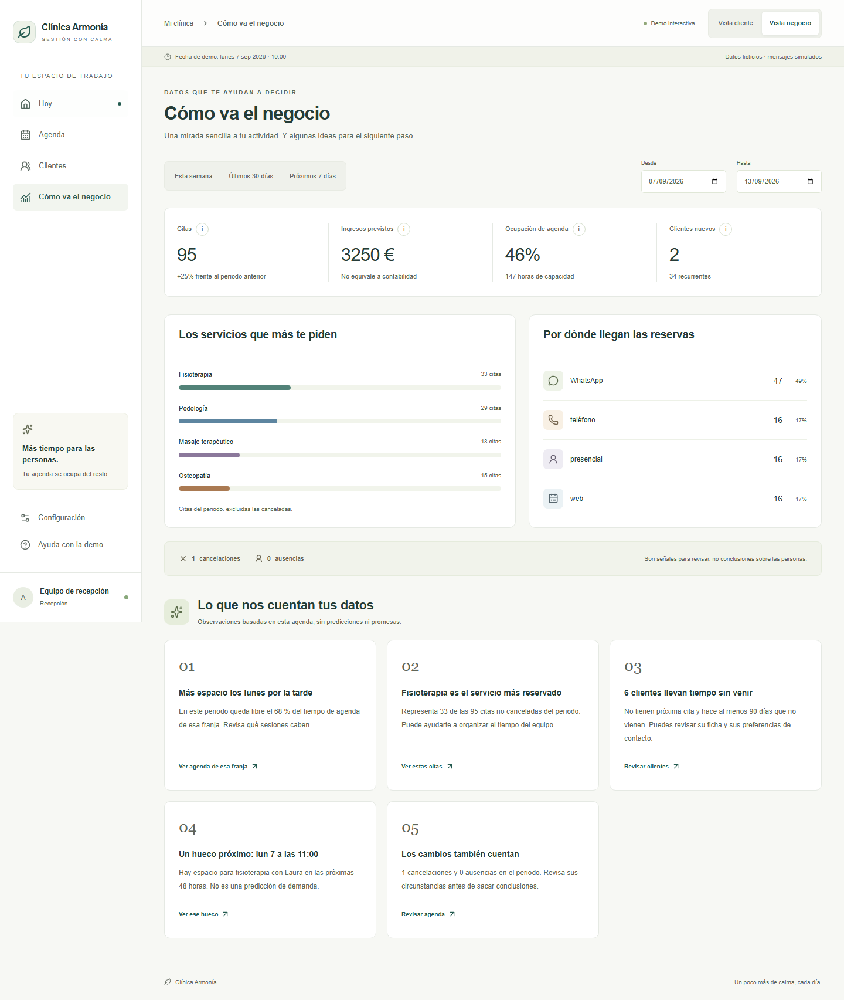

# Clínica Armonía

> ⚠️ Este proyecto es una demostración comercial. No es una aplicación preparada para producción ni debe utilizarse para gestionar datos médicos o personales reales.

Piloto comercial de reservas para una clínica ficticia. Interfaz en español, aplicación local y base SQLite compartida entre móvil y ordenador. Los mensajes y recordatorios son simulados; no se necesitan cuentas externas.

La demo muestra cómo reducir las llamadas para reservar y dar a recepción una visión clara de su día. El cliente elige servicio, fecha y hora, recibe confirmación inmediata, descarga su calendario y gestiona cambios o cancelaciones. El negocio crea y modifica citas, registra asistencia, consulta clientes, prepara mensajes, interpreta indicadores y exporta datos filtrados.

**Estado:** piloto implementado y validado localmente. **Versión preparada:** `v0.1.0-demo`. **Publicación en GitHub:** pendiente de instalar y autenticar GitHub CLI. Está preparado para la pre-release privada `clinica-armonia-demo`; no hay una versión publicada todavía.

## Capturas representativas

Capturas de la demo con datos ficticios; las fechas concretas dependen de cuándo se generaron las semillas.



| Reserva desde el móvil                                       | Entrada desde WhatsApp simulado                               |
| ------------------------------------------------------------ | ------------------------------------------------------------- |
|  |  |



## Tecnologías y funciones incluidas

Next.js, React y TypeScript; Tailwind CSS y Radix Dialog; SQLite con `better-sqlite3`; Zod; `date-fns` y zona Europe/Madrid. Vitest, Playwright y axe-core verifican las reglas y los recorridos. Las versiones exactas quedan en `package-lock.json`.

- Reserva online y manual, disponibilidad calculada, confirmación inmediata y localizador.
- Agenda de día/semana, filtros, estados, notas e historial de cambios.
- Clientes con búsqueda, historial, preferencias de contacto y etiquetas explicables.
- Indicadores del periodo, comparación anterior y recomendaciones deterministas.
- Configuración de marca, servicios, equipo, horarios, bloqueos, antelación, márgenes y mensajes.
- CSV para Excel y copia de tablas con filtros y exclusión de notas.
- Persistencia local, semillas reproducibles, restablecimiento protegido y adaptación móvil/tablet/escritorio.

## Arrancar

Requisitos: Node.js 24 (24.13.1 verificado) y npm. Desde esta carpeta:

```powershell
npm ci
npm run dev
```

Abre http://localhost:3000 para ver la landing y http://localhost:3000/demo para el panel (botón **Ver demo**). La primera ejecución crea `data/armonia.db` con datos de ejemplo. Recargar la página o reiniciar el servidor conserva los cambios. Internet solo se necesita para instalar las dependencias y, opcionalmente, los navegadores de pruebas. Los recursos de la aplicación son locales.

Para presentar una versión compilada:

```powershell
npm run build
npm start
```

Detén el servidor con Ctrl+C. Usa un solo servidor por archivo de base de datos.

## Restablecer los datos ficticios

Abre **Vista negocio → Configuración → Restablecer demo**, escribe `RESTABLECER` y confirma. Se recuperan la marca, los servicios, clientes y citas iniciales; se eliminan los cambios de la demostración y se fija una nueva fecha interna. No se publica ni se incluye una base SQLite inicial: se genera automáticamente.

## Móvil y ordenador

1. Conecta ambos a la misma wifi.
2. En Windows, ejecuta `ipconfig` y localiza la dirección IPv4 del adaptador wifi.
3. En el móvil, abre `http://DIRECCION-IP:3000/?vista=cliente`.
4. Mantén el panel abierto en el ordenador. Se actualiza cada tres segundos cuando la pestaña está visible.

El servidor escucha en la red local. Si no conecta, revisa que Windows permita Node en la red privada, que la wifi no tenga aislamiento de clientes y que no estés usando una red de invitados. No publiques este servidor en Internet: el piloto no incluye autenticación de producción.

## Recorrido comercial · 5–7 minutos

| Paso     | Qué enseñar                                                            | Beneficio que verbalizar                                                                  |
| -------- | ---------------------------------------------------------------------- | ----------------------------------------------------------------------------------------- |
| 1 · 45 s | Vista cliente, mensaje de WhatsApp                                     | «Tu cliente reserva cuando le viene bien, sin interrumpir una sesión.»                    |
| 2 · 60 s | Fisioterapia, primer día y primera hora, datos ficticios, confirmación | «Ve precio, duración y profesional antes de confirmar. No tiene que esperar una llamada.» |
| 3 · 45 s | Vista negocio, nueva reserva en Hoy                                    | «Lo que reserva el cliente aparece directamente en la agenda.»                            |
| 4 · 60 s | Ficha de cita, cambio de fecha e historial                             | «Recepción puede resolver cambios en el momento, conservando el contexto.»                |
| 5 · 45 s | Ficha de cliente recurrente                                            | «Sabes cuándo vino y qué prefiere, sin convertir la agenda en una historia clínica.»      |
| 6 · 60 s | Cómo va el negocio y una conclusión                                    | «Los datos te señalan dónde quedan huecos y te llevan a una acción concreta.»             |
| 7 · 30 s | Exportación filtrada                                                   | «Si trabajas con Excel, puedes seguir haciéndolo con la misma información.»               |

Usa un nombre inventado y el teléfono `000 987 654`. Los contactos semilla usan números ficticios y correos `example.invalid`. Los botones de contacto preparan simulaciones; nunca llaman ni envían mensajes a los contactos de ejemplo.

## Reglas de la demostración

- El reloj se fija a las 10:00 de un día laborable al inicializar o restablecer. Está visible en todas las pantallas. Es deliberadamente fijo para poder repetir la presentación; «Hoy», antelación y estadísticas utilizan ese reloj, no la hora del móvil.
- Servicios, precios, profesionales, horarios, márgenes y mensajes se centralizan en `src/domain/defaults.ts` y se pueden editar desde Configuración.
- La disponibilidad se calcula en el servidor. Confirmar y reprogramar vuelven a comprobarla dentro de una transacción inmediata.
- Una hora puede seguir disponible si otro profesional compatible está libre. El primer hueco de Fisioterapia del día demo tiene una sola plaza para mostrar cómo desaparece tras reservarlo.
- La confirmación del cliente es inmediata. Pendientes y confirmadas ocupan agenda; cancelar libera la plaza. Atendidas y no presentadas conservan su intervalo histórico.
- Antelación inicial: una hora y hasta 60 días. Separación: diez minutos después de la sesión, dentro del horario. El cliente puede cambiar/cancelar hasta 24 h antes; recepción puede gestionar citas próximas.
- La duración, el precio y el margen de las citas existentes se conservan al editar el catálogo. Cambiar de servicio actualiza esas condiciones; cambiar solo de fecha las conserva.
- Los teléfonos se normalizan. Una coincidencia de nombre y teléfono reutiliza la ficha; compartir teléfono con otra persona no sobreescribe sus datos.
- No hay pagos ni envíos automáticos. Los archivos de calendario `.ics` son descargas locales, sin sincronización.

## Estructura

- `src/components`: interfaces de cliente y negocio.
- `src/domain`: modelo, reglas, semillas, cálculos y presentación de datos.
- `src/server`: SQLite y migración inicial versionada.
- `src/app/api`: API local con validación y respuestas públicas sin notas internas.
- `tests` y `e2e`: pruebas de reglas y recorridos.

La base usa claves externas e índices de agenda. Cada cambio guarda solo las filas modificadas. El historial se escribe en la misma transacción que la reserva. Las operaciones repetidas tienen clave de idempotencia y las ediciones comprueban la versión de la cita.

## Verificación

```powershell
npm test
npm run typecheck
npm run lint
npx playwright install chromium
npm run test:e2e
npm run build
```

Las pruebas de navegador utilizan el puerto 3100 y `data/e2e.db`, separado de tu demo habitual. Las capturas y trazas de fallos quedan en `test-results`. No ejecutes simultáneamente dos pruebas de navegador sobre esa base.

Validación realizada: **18 pruebas de reglas e integración y 7 pruebas de navegador aprobadas**, además de TypeScript, lint y compilación de producción. Se ha reconstruido desde una copia que contenía únicamente código y configuración, instalando las dependencias con `npm ci`. Se han revisado vistas de 390, 820 y 1440 píxeles y accesibilidad automática con axe-core. Esto no sustituye comprobar el móvil y la wifi concretos de la presentación.

El progreso por fases se mantiene en `TASKS.md`. El piloto excluye historia clínica, facturación fiscal, pagos, permisos complejos, múltiples empresas e integraciones reales.

## Simulaciones y limitaciones

WhatsApp, recordatorios y comunicaciones son **simulados**: no se envían mensajes, correos ni campañas. No existe autenticación ni aislamiento multiempresa de producción. El calendario es una descarga `.ics`, no una sincronización. La fecha interna es fija, el servidor debe estar encendido y los ingresos no representan contabilidad.

Consulta [DEMO_LIMITATIONS.md](DEMO_LIMITATIONS.md) para las limitaciones y el trabajo necesario antes de ofrecer un servicio real. Quedan fuera de alcance pagos, facturación fiscal, historia clínica, chatbot, IA externa, aplicación móvil nativa y sincronizaciones con WhatsApp, Google u Outlook.

## Capturas y mantenimiento

`npm run screenshots` genera las imágenes de documentación usando la compilación local, el puerto 3101 y una base separada `data/screenshots.db`. Ejecuta antes `npm run build`. `npm run format` aplica el formato del código.

Los archivos de bases de datos, dependencias, compilaciones, credenciales, logs y resultados temporales de pruebas están excluidos de Git. Solo se incluyen las capturas seleccionadas de `docs/screenshots`.
